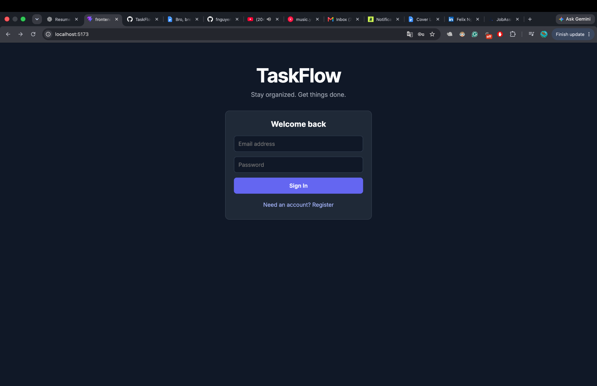
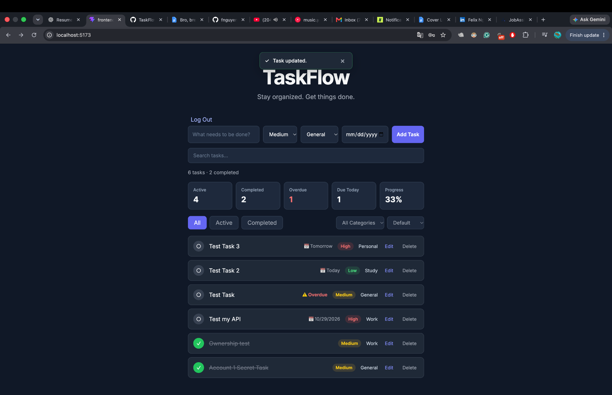

# TaskFlow

A full-stack task management application built with **React, JavaScript, ASP.NET Core, C#, and SQLite**.

TaskFlow helps users organize their tasks, manage priorities, track deadlines, and stay productive through a clean, interactive interface.

## Application Preview




## Features

- **User authentication** — Register an account, sign in, and log out.
- **Task management** — Create, edit, complete, and delete tasks.
- **Task priorities** — Organize tasks by High, Medium, and Low priority.
- **Due dates** — Set deadlines and track upcoming or overdue tasks.
- **Search and filtering** — Find tasks and filter them by status or category.
- **Sorting** — Organize tasks by completion, priority, and due date.
- **Dashboard statistics** — View task progress at a glance.
- **User-specific data access** — Protect task endpoints and restrict users to their own tasks.
- **Input validation** — Validate task titles and priority values on the backend.
- **Automated API tests** — Test API behavior, validation, authentication, and task ownership.

## Tech Stack

| Technology | Purpose |
|---|---|
| React | Frontend user interface |
| JavaScript | Frontend logic |
| ASP.NET Core Minimal APIs | Backend REST API |
| C# | Backend application logic |
| Entity Framework Core | Database access and ORM |
| SQLite | Relational database |
| ASP.NET Core Identity | User authentication |
| xUnit | Automated backend testing |
| Git and GitHub | Version control and source hosting |

## Architecture

TaskFlow separates the frontend, backend, and database into distinct layers.

```text
React Frontend
      |
      | HTTP requests + Bearer tokens
      v
ASP.NET Core REST API
      |
      | Entity Framework Core
      v
   SQLite Database
```

Authenticated task requests are associated with the current user. The backend checks task ownership before allowing users to edit, complete, or delete tasks.

## Getting Started

### Prerequisites

Install the following:

- [.NET SDK](https://dotnet.microsoft.com/download)
- [Node.js](https://nodejs.org/)
- [Git](https://git-scm.com/)

### 1. Clone the repository

```bash
git clone https://github.com/fnguyen0720/TaskFlow.git
cd TaskFlow
```

### 2. Start the backend

Open a terminal:

```bash
cd backend/TaskFlow.Api
dotnet restore
dotnet run
```

The backend is configured to use SQLite through its connection string in `appsettings.json`. The development launch profile specifies the local API URL.

If the database has not been initialized, apply the existing Entity Framework Core migrations before running the application.

### 3. Start the frontend

Open a second terminal from the repository root:

```bash
cd frontend
npm install
npm run dev
```

Open the local URL printed by Vite in the terminal. The frontend's configured API URL and the backend's CORS origin must match your local development settings.

## Testing

The backend includes automated API integration tests using xUnit and a custom web application factory.

Run the tests from the repository root:

```bash
dotnet test backend/TaskFlow.Api.Tests/TaskFlow.Api.Tests.csproj
```

The project currently has **21 passing API tests** in the local test run.

## Project Goals

TaskFlow was built to develop practical full-stack engineering skills, including:

- Designing and implementing REST API endpoints
- Building an interactive React frontend
- Connecting a frontend to a backend
- Modeling relational data with Entity Framework Core
- Implementing authentication and user-specific authorization
- Validating requests and handling API errors
- Writing automated integration tests
- Managing source code with Git and GitHub

## Future Improvements

- Deploy the application for public access
- Add a live demo and application screenshots
- Improve production configuration and deployment workflows

## Author

**Felix Nguyen**

[GitHub Profile](https://github.com/fnguyen0720)

