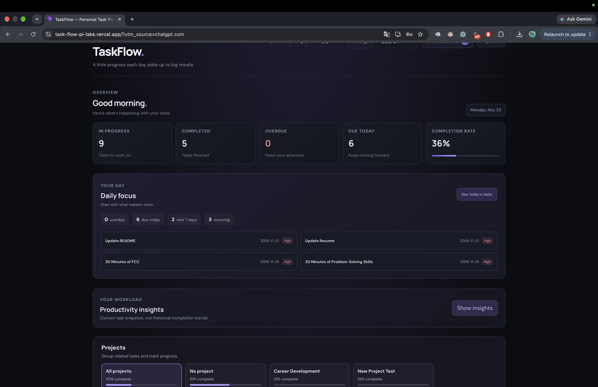
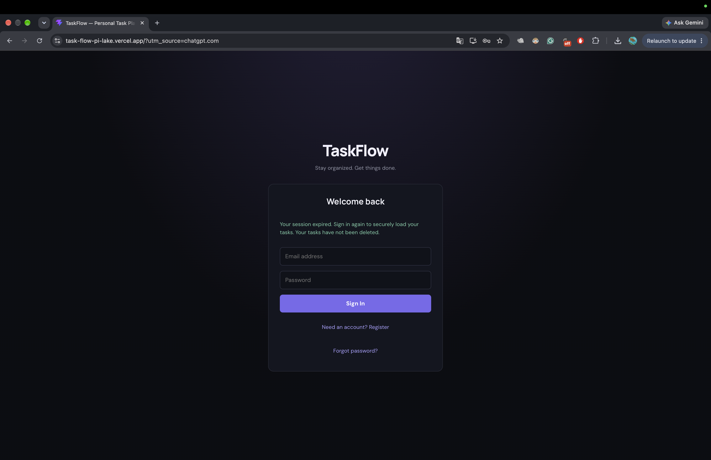

# TaskFlow

**A production-deployed, full-stack task and project management application** built with React, ASP.NET Core (.NET 10), Entity Framework Core, and PostgreSQL.

TaskFlow supports daily task planning, project organization, recurring work, deadline visibility, and reliable task editing across devices. It is also an engineering portfolio project focused on secure multi-user APIs, database migrations, automated testing, and production operations.

**[Launch TaskFlow](https://task-flow-pi-lake.vercel.app)** · **[Source code](https://github.com/fnguyen0720/TaskFlow)**

## Preview

| Dashboard | Authentication |
| --- | --- |
|  |  |

> Screenshots may not show the latest UI. The live app contains the current feature set. Create your own account to explore your private workspace.

## What you can do

### Organize tasks and projects
- Create, edit, complete, and delete tasks; undo accidental deletion during the short recovery window.
- Assign priorities, categories, due dates, notes, and checklist items.
- Create and rename private projects, see project progress, filter by project, and move tasks between projects.
- Create a task directly inside the currently selected project; ungrouped tasks remain supported.
- Search, sort, and filter work by status, schedule, category, and project.
- Use All, Today, Upcoming, Unscheduled, and calendar views; view dashboard statistics and current-snapshot productivity insights.

### Plan and navigate
- Schedule recurring tasks and manage reminder and notification preferences.
- Use weekly and monthly calendars, including drag-and-drop scheduling in the week view and accessible date-based moves.
- Open the command palette with **Ctrl/⌘ + K** to search and navigate quickly.
- Use a responsive mobile layout, keyboard-friendly dialogs, accessible focus states, and an installable **online-only PWA**. Offline task editing and synchronization are **not** supported.

### Edit with confidence
- Preserve unsaved task drafts across many navigation and save-failure scenarios; show clear retry and discard options.
- Detect stale edits and reject conflicting writes rather than silently overwriting newer task data.
- View a private activity timeline for task changes.
- Compare historical task snapshots and restore a previous version with confirmation and conflict checks.
- Load larger workspaces using bounded API pagination and incremental list rendering.
- Verify signed-in account identity and distinguish loading failures from genuinely empty workspaces.

### Account and security features
- Account registration, sign-in, sign-out, and authenticated Bearer-token API requests.
- ASP.NET Core Identity, owner-scoped queries, and backend ownership validation for tasks, projects, history, and preferences.
- Input validation, rate limiting on identity endpoints, and explicit trusted-origin CORS configuration.
- Provider-gated password recovery and email verification interfaces. **Email delivery and public recovery availability depend on verified operator configuration; do not assume they are enabled.**
- In-app notification center with configurable overdue, due-today, and upcoming alerts.

> **In development:** Task dependencies and more advanced nested subtasks are currently proposed in [PR #55](https://github.com/fnguyen0720/TaskFlow/pull/55). They are not represented here as released features.

## Technology stack

| Layer | Technologies |
| --- | --- |
| Frontend | React, JavaScript, Vite, CSS |
| Backend | C#, ASP.NET Core Minimal APIs (.NET 10), ASP.NET Core Identity |
| Data | Entity Framework Core, SQLite (local), PostgreSQL (production) |
| Testing | xUnit API/integration tests, frontend unit tests, Playwright browser tests |
| Delivery | GitHub Actions CI, Vercel (frontend), Render (API and PostgreSQL) |
| Operations | Production smoke checks, synthetic latency sampling, security/dependency audits, documented recovery procedures |

## Architecture

```text
Browser / installable online-only PWA
              |
              | HTTPS + Bearer token
              v
React + Vite frontend (Vercel)
              |
              | authenticated REST requests
              v
ASP.NET Core Minimal API (.NET 10) (Render)
   | ASP.NET Core Identity + owner checks
   | task/project/history/notification endpoints
   v
Entity Framework Core
   |                     |
   v                     v
SQLite (local)      PostgreSQL (production)
```

The server—not the browser—establishes account ownership and validates cross-resource operations. PostgreSQL production changes use reviewed additive EF Core migrations and an explicit migration allowlist. The application is not a shared/team collaboration product; projects and task data are scoped to individual accounts.

## Engineering highlights

- **Concurrency safety:** conditional task updates and version-aware restoration detect stale writes.
- **Account isolation:** authorization and ownership checks protect records across tasks, projects, version history, activities, and settings.
- **Data preservation:** additive schema changes and tests prioritize retaining existing task records and compatible clients.
- **Resilience:** request cancellation/session guards, error recovery, preserved drafts, and explicit empty/loading/error states.
- **Testing:** API integration, PostgreSQL isolation, frontend unit, and Playwright browser regression suites run through dedicated GitHub Actions workflows.
- **Operations:** automated smoke checks and read-only synthetic latency measurements. A **disposable CI-only PostgreSQL dump/restore rehearsal** tests recovery logic; this is **not evidence that production backups are configured or verified**.

Further implementation notes are in [docs/](docs/), including [projects](docs/projects-and-grouping.md), [version history](docs/task-version-history.md), [edit conflicts](docs/task-edit-conflicts.md), [recurring tasks](docs/recurring-tasks.md), [account recovery](docs/account-recovery.md), and [backup readiness](docs/backup-and-recovery.md).

## Run locally

### Prerequisites
- [.NET 10 SDK](https://dotnet.microsoft.com/download)
- [Node.js and npm](https://nodejs.org/)
- Git
- EF Core CLI (`dotnet-ef`) for database migrations

### 1. Clone

```bash
git clone https://github.com/fnguyen0720/TaskFlow.git
cd TaskFlow
```

### 2. Configure and start the API

Use the development connection-string and trusted frontend-origin settings described in `backend/TaskFlow.Api/appsettings.Development.json` and [backend security notes](docs/backend-security-hardening.md). Never commit real secrets.

```bash
cd backend/TaskFlow.Api
dotnet restore
dotnet ef database update --context TaskDbContext
dotnet run
```

Local development uses SQLite. Production uses the separate `PostgreSqlTaskDbContext` and a `TASKFLOW_POSTGRES_CONNECTION` value configured on the server. **Do not apply local-development commands or migrations to a production database.**

### 3. Start the frontend

In another terminal, from the repository root:

```bash
cd frontend
npm install
npm run dev
```

Open the URL printed by Vite. Match the frontend API base URL and backend CORS allowed origins to your local setup. Vercel preview origins must be explicitly permitted by the API when testing end to end.

## Test and verify

```bash
# From repository root: backend tests
dotnet test backend/TaskFlow.Api.Tests/TaskFlow.Api.Tests.csproj

# Frontend checks
cd frontend
npm ci
npm test
npm run lint
npm run build
```

Playwright browser suites and real PostgreSQL integration checks are also configured in `.github/workflows/`. See the relevant workflow definitions and `frontend/e2e/` for their execution commands and test environment requirements.

## Deployment and operational safeguards

| Component | Hosting |
| --- | --- |
| React web client | Vercel |
| ASP.NET Core API | Render |
| PostgreSQL | Render |

Runtime configuration is supplied via environment variables, not hardcoded production credentials. Production workflows include read-only smoke checks, failure alerting, and latency sampling. The recovery documentation clearly distinguishes test-only restore rehearsals from real production backup verification.

## Roadmap

- Complete and validate [task dependencies and advanced subtasks](https://github.com/fnguyen0720/TaskFlow/pull/55).
- Continue expanding accessibility and cross-browser regression coverage.
- Improve operational visibility and verify production backup practices.
- Extend performance and user experience for larger datasets.

## Author

**Felix Nguyen** · [GitHub](https://github.com/fnguyen0720) · [LinkedIn](https://www.linkedin.com/in/felix-nguyen-41abb2373/)
