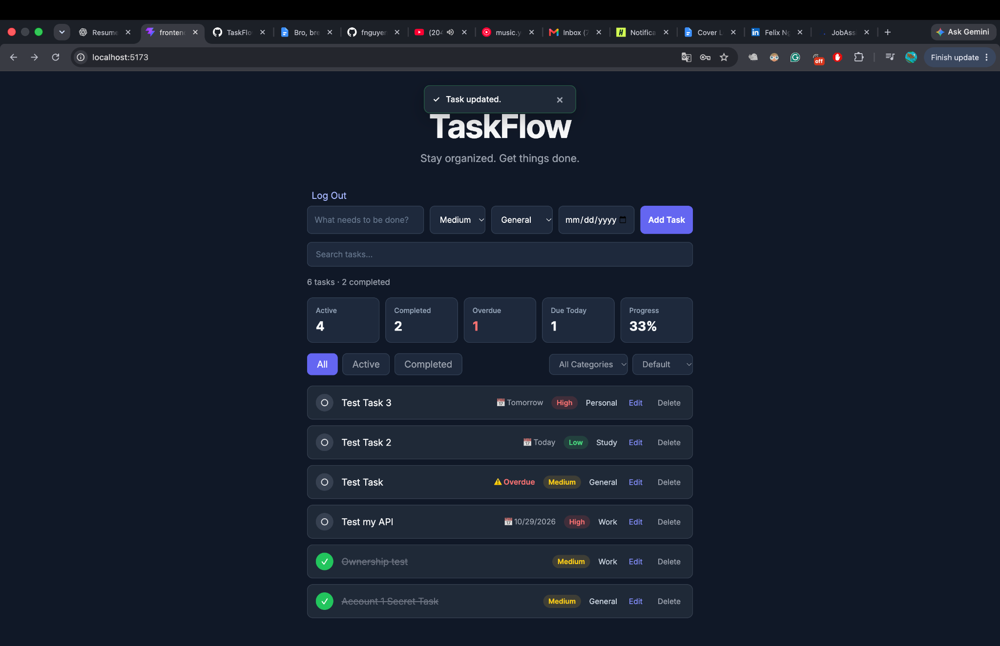
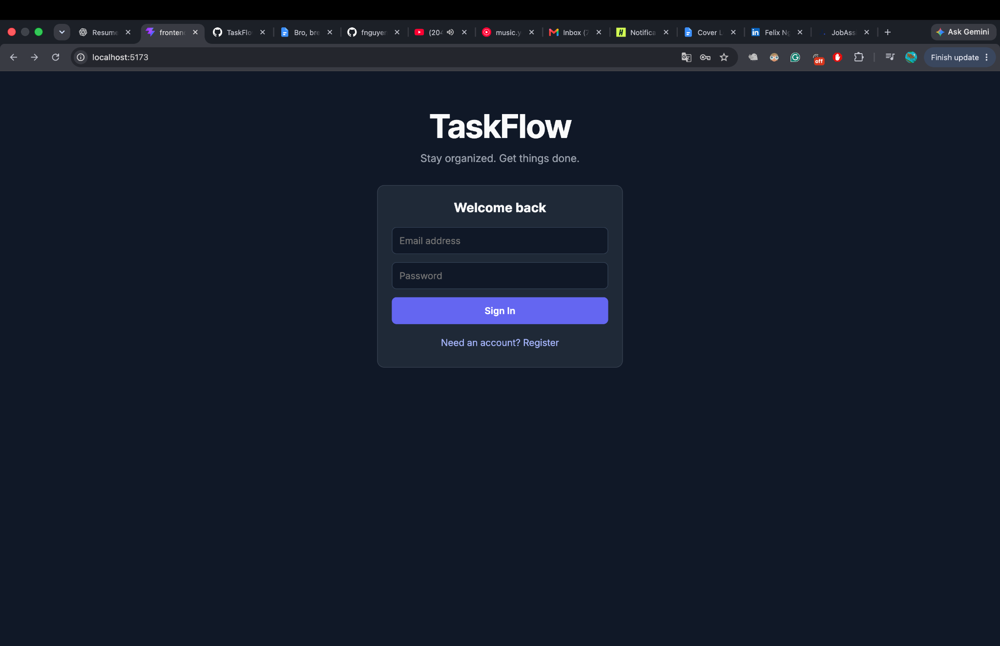

# TaskFlow

A full-stack task management application built with **React, JavaScript, ASP.NET Core, C#, and Entity Framework Core**.

TaskFlow helps users organize their tasks, manage priorities, track deadlines, and stay productive through a clean, interactive interface.

**[Live Demo](https://task-flow-pi-lake.vercel.app)** · **[GitHub Repository](https://github.com/fnguyen0720/TaskFlow)**

## Application Preview

### Task Dashboard



### User Authentication



## Features

- **User authentication** — Register an account, sign in, and log out.
- **Task management** — Create, edit, complete, and delete tasks.
- **Task priorities** — Organize tasks by High, Medium, and Low priority.
- **Due dates** — Set deadlines and track upcoming or overdue tasks.
- **Search and filtering** — Find tasks and filter them by status or category.
- **Sorting** — Organize tasks by completion, priority, and due date.
- **Dashboard statistics** — View task progress at a glance.
- **User-specific data access** — Protect task endpoints and restrict users to their own tasks.
- **Input validation** — Validate task titles and priority values on the backend.
- **Automated API tests** — Test API behavior, validation, authentication, and task ownership.

## Tech Stack

| Technology | Purpose |
|---|---|
| React | Frontend user interface |
| JavaScript | Frontend logic |
| ASP.NET Core Minimal APIs (.NET 10) | Backend REST API |
| C# | Backend application logic |
| Entity Framework Core | Database access and ORM |
| SQLite | Local development database |
| PostgreSQL | Production relational database |
| ASP.NET Core Identity | User authentication |
| xUnit | Automated backend testing |
| Vercel | Frontend hosting |
| Render | Backend API and database hosting |
| Git and GitHub | Version control and source hosting |

## Architecture

TaskFlow separates the frontend, backend, and database into distinct layers.

### Production Architecture

```text
React Frontend
     |
     | HTTPS requests + Bearer tokens
     v
ASP.NET Core REST API
     |
     | Entity Framework Core
     v
PostgreSQL Database
```

### Local Development Architecture

```text
React Frontend (Vite)
     |
     | HTTP requests + Bearer tokens
     v
ASP.NET Core REST API
     |
     | Entity Framework Core
     v
SQLite Database
```

The frontend communicates with the backend through HTTP requests. ASP.NET Core Identity handles authentication, while authorization ensures users can only access and modify their own tasks.

Entity Framework Core manages database operations, allowing the application to use SQLite locally and PostgreSQL in production.

## Production Deployment

TaskFlow is deployed using the following services:

| Service | Platform | Responsibility |
|---|---|---|
| Frontend | Vercel | Hosts the React application |
| Backend | Render | Hosts the ASP.NET Core API |
| Database | Render PostgreSQL | Stores user accounts and tasks |

The frontend communicates with the production API over HTTPS. Authenticated requests include Bearer tokens, and the backend enforces user-specific authorization.

Production configuration is managed through environment variables rather than hardcoded credentials.

**Live Application:** [https://task-flow-pi-lake.vercel.app](https://task-flow-pi-lake.vercel.app)

## Getting Started

### Prerequisites

Install the following:

- [.NET 10 SDK](https://dotnet.microsoft.com/download)
- [Node.js](https://nodejs.org/)
- [Git](https://git-scm.com/)

### 1. Clone the repository

```bash
git clone https://github.com/fnguyen0720/TaskFlow.git
cd TaskFlow
```

### 2. Start the backend

Open a terminal:

```bash
cd backend/TaskFlow.Api
dotnet restore
dotnet run
```

The local backend uses SQLite through its configured connection string in `appsettings.json`.

If the database has not been initialized, apply the existing Entity Framework Core migrations before running the application.

### 3. Start the frontend

Open a second terminal from the repository root:

```bash
cd frontend
npm install
npm run dev
```

Open the local URL printed by Vite in the terminal.

The frontend API URL and backend CORS configuration must match your local development settings.

## Testing

The backend includes automated API integration tests using xUnit and a custom web application factory.

Run the tests from the repository root:

```bash
dotnet test backend/TaskFlow.Api.Tests/TaskFlow.Api.Tests.csproj
```

The project currently has **21 passing API tests** in the local test suite.

## Project Goals

TaskFlow was built to develop practical full-stack engineering skills, including:

- Designing and implementing REST API endpoints.
- Building an interactive React frontend.
- Connecting a frontend to a backend.
- Modeling relational data with Entity Framework Core.
- Implementing authentication and user-specific authorization.
- Validating requests and handling API errors.
- Writing automated integration tests.
- Configuring and deploying a full-stack application.
- Managing source code with Git and GitHub.

## Future Improvements

- Add automated frontend testing.
- Implement password recovery.
- Improve application monitoring and structured logging.
- Add pagination for larger task collections.
- Improve session expiration and token-refresh handling.

## Author

**Felix Nguyen**

[GitHub Profile](https://github.com/fnguyen0720)